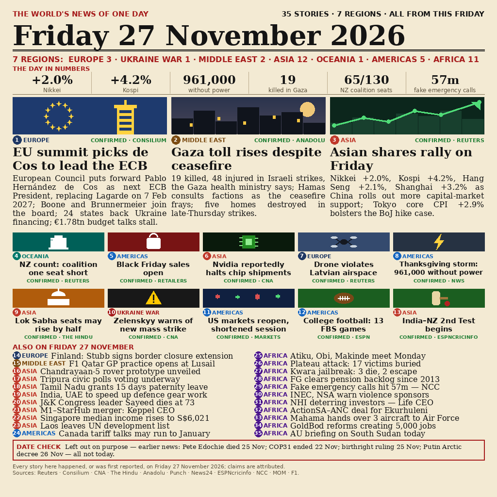

# Friday 27 November 2026 — 41 stories, 11 regions

[](https://make.fun/bounty/news-image-20261127?utm_source=github&utm_medium=readme&utm_campaign=news-image-20261127)
[](https://make.fun/bounty/news-image-20261127/leaderboard?utm_source=github&utm_medium=readme&utm_campaign=news-image-20261127)
[](https://make.fun/bounty/news-image-20261127?utm_source=github&utm_medium=readme&utm_campaign=news-image-20261127)

Entry for the [make.fun news-image-20261127 bounty](https://make.fun/bounty/news-image-20261127):
a one-day front page — **41 stories, 11 regions, all from Friday 27 November 2026**.



## What's inside

- **3 leads:** EU summit ends with no deal; de Cos to lead the ECB · Gaza toll rises despite ceasefire · Asian shares rally on Friday
- **12 minis:** Houthis hit Saudi refinery; 50 targets struck in reply · Russia fires 155 drones at Ukraine overnight; 110 downed · Thanksgiving storm: 961,000 without power at its peak · NZ count — coalition one seat short · Nvidia reportedly halts chip shipments to four SE Asian states · F1 Qatar: Antonelli sweeps Friday practice · Drone violates Latvian airspace, NATO jets scrambled · Lok Sabha seats may rise by half · US markets reopen; best week in a year · Ukraine downs jet drone with a laser, first time · India–NZ 2nd Test begins at Christchurch · Black Friday sales open
- **26 briefs:** Finland signs border closure extension · Spain concludes election campaign · Chandrayaan-5/LUPEX rover prototype · India–UAE defence equipment · India top court: PMLA benches need a judicial member · M1–StarHub merger · Singapore median income S$6,021 · Laos leaves UN development list · Canada tariff talks into January · Canada top court upholds Quebec secularism law · US Army deploys first hypersonic battery · Venezuela considers easing curbs on opposition figures · College football Black Friday — 13 FBS games · Morocco to invest $222m in tourism · Kiir lifts emergency in four states · Atiku, Obi, Makinde meet Monday · Plateau mass burial · Kwara jailbreak · Pension backlog cleared · INEC/NSA riot act · NHI deterring investors · Mahama hands over aircraft · UN names 16 hunger hotspots · Taiwan holds local elections Saturday · China five-year defence education plan · Trump rewrites NATO statement to add Ukraine

**Regions:** EUROPE 4 · UKRAINE WAR 2 · MIDDLE EAST 3 · N. AFRICA 1 · SUB-SAHARAN AFRICA 8 · S. ASIA 5 · E. ASIA 3 · SE ASIA 4 · OCEANIA 1 · AMERICAS 9 · GLOBAL 1.

## Date discipline

Every story happened, or was first reported, on Friday 27 November 2026.
Stories from 22–26 Nov (Kuwait drone attack, Bangkok refinery explosion, UK
net migration, Kyiv missile strike, Ebola 12,021 cases, Pete Edochie dies at
79, COP31, the birthright ruling, Putin's Arctic strategy, Development Road
talks…) were checked and deliberately left out — see the date-check box on
the page.

## How it was built

The front page is drawn entirely in code (`main.py`, Python + PIL): dark ink
on light paper, giant coloured number strip, region chips, a UTC timeline, a
world map with numbered pins, trust legend, legible at 390px. `main.py`
renders `entry.png` (1024×1024 RGB, ≤1 MiB) and copies it to
`/output/entry.png` with size + sha256 verification. Rebuild with:

```sh
python3 main.py
```
